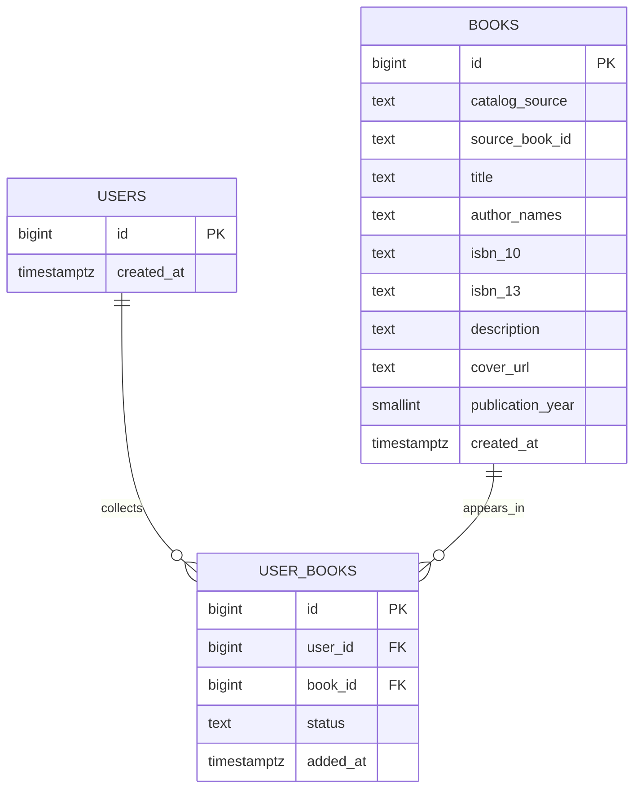

# Book Hunt database design — first version

This document plans the first PostgreSQL tables before we write a migration. The first database increment will cover the catalog and one reader's library. Ratings, notes, taste preferences, scans, and store visits come later.

## What the database does

A database is the backend's durable, organized store of application data. React sends requests to the Node.js API; only the API connects to PostgreSQL. This keeps SQL and database credentials out of the browser.

```text
React in the browser
        │ HTTP + JSON
        ▼
Node.js API
        │ SQL
        ▼
PostgreSQL
```

## Relational database vocabulary

- A **table** holds one kind of thing, such as books.
- A **row** is one instance, such as one catalog book.
- A **column** is one property of each row, such as a title.
- A **primary key (PK)** is a stable, unique identifier for one row. Other tables can refer to it even when a title or name changes.
- A **foreign key (FK)** points to a row in another table. PostgreSQL can reject a reference to something that does not exist.
- A **constraint** is a rule the database enforces, such as requiring a title or preventing the same catalog record from being inserted twice.
- A **relationship** describes how rows in tables relate. One-to-one means one row matches at most one row; one-to-many means one row can match several rows; many-to-many means several rows on each side can be related.
- An **index** is an extra lookup structure that can speed up selected queries. It takes disk space and adds work to inserts and updates, so we add indexes for known lookups rather than every column.
- A **transaction** groups SQL changes into one unit: either all succeed, or none are kept. This matters when saving a book and adding it to the reader's library together.
- A **migration** is a versioned SQL change to the database structure. It lets development and later deployment apply the same schema changes in a known order.

For example, a stored `users` row and a stored `user_profiles` row could be one-to-one if `user_profiles.user_id` were both a foreign key and unique. We are not adding that table now: the current profile is intentionally kept in browser IndexedDB.

## Planned first schema



### `users`

The app currently has one owner and no login. This table will contain one seeded owner row so that personal library records have a consistent owner key. Its `id` is generated by PostgreSQL and `created_at` defaults to the current time. It will not contain passwords, emails, or login sessions. Those are outside the current product scope.

### `books`

This table holds catalog metadata once, independently of who saves the book. Its `id` is generated by PostgreSQL; `title`, `catalog_source`, and `source_book_id` are required; `created_at` defaults to the current time. The pair `catalog_source` and `source_book_id` identifies the record at a metadata provider and must be unique. ISBNs, description, cover URL, and publication year can be absent; ISBNs are text so leading zeroes are preserved. A present publication year must be between 1 and 3000. The first version stores provider-supplied author names as display text; if author relationships become a query requirement, we can normalize them into `authors` and `book_authors` in a later migration.

### `user_books`

This is the join table between a reader and a catalog book. It represents the many-to-many relationship: a reader can collect many books, and a catalog book can appear in many readers' libraries. The app is single-user today, but the join table cleanly separates catalog facts from that reader's status. Its foreign keys are required, `added_at` defaults to the current time, and `status` defaults to `want_to_read`. A unique constraint on `(user_id, book_id)` prevents duplicate saves. A check constraint limits `status` to `want_to_read`, `reading`, `read`, or `did_not_finish`.

The initial migration will not include ratings or notes. Those are introduced with the later Ratings and Notes feature so the schema grows with the app.

## Normalization and deliberate limits

Normalization means organizing data to reduce accidental repetition and update conflicts. If each library row copied a book title, author, and cover, correcting a title could require changing many rows. Keeping the catalog record in `books` and a reference in `user_books` means the catalog details have one home. The join table contains the relationship and reader-specific status.

The `author_names` text is a deliberate first-version simplification: we display provider-supplied names but do not yet manage author entities or author biographies. If searching, deduplicating, or linking an author across books becomes a required database feature, we can migrate to separate author tables.

The reader profile currently lives in IndexedDB on the browser device. It is not in PostgreSQL and does not sync with this database. The `users` row is an owner key, not an authentication account.

## Rules and first indexes

- Primary keys identify rows and receive indexes automatically.
- A unique constraint on `(catalog_source, source_book_id)` prevents duplicate provider records.
- `user_books.user_id` references `users.id`; `user_books.book_id` references `books.id`.
- Deleting a user would cascade to their join rows. Deleting a book that is already in a library should be rejected (`RESTRICT`) so we cannot silently orphan a reader's choice.
- A unique constraint on `(user_id, book_id)` prevents duplicate library entries.
- A check constraint validates the library status and a second check can constrain publication years.
- The provider identity and join uniqueness constraints create useful indexes automatically. Add a separate ISBN index for ISBN lookup. Add title/author search indexes only after we choose and measure the actual search behavior.

## Saving a selected search result

When a search result is saved, the API finds or inserts its catalog row, then attaches it to the owner in a transaction:

```text
BEGIN
  find or insert the provider's book record
  insert the owner + book relationship and initial status
COMMIT
```

If either write fails, the transaction rolls both back. This prevents an incomplete save where a book was added to the catalog but the user's library link was not created.

## Migration plan

The first numbered SQL migration is `database/migrations/001_initial_catalog_library.sql`. It creates `users`, `books`, and `user_books`, adds their primary keys, foreign keys, uniqueness rules, indexes, and checks, and inserts one owner row. The Node.js migration runner creates a `schema_migrations` table to record applied versions and runs each file inside a transaction. A PostgreSQL advisory lock keeps two migration processes from applying the same version at once. Later features will add their own migrations rather than rebuilding the whole schema at once.

The runner reads `DATABASE_URL` from the environment or `backend/.env`. Copy `backend/.env.example` to `backend/.env`, set the connection string for a local database, then run `npm run migrate` from `backend/`. The `.env` file is ignored by Git so local connection details are not committed. The My Library API uses the same connection to list saved books, change statuses, and remove the owner's library relationship.

**Verification status:** Applied `001_initial_catalog_library.sql` to the local PostgreSQL 18.6 database and confirmed that `books`, `users`, `user_books`, and `schema_migrations` exist. This machine's database is named `book_hunter_dev`; `backend/.env` points to that local database. The example setup uses `book_hunt_dev`, so new setups should keep their database name and connection string in sync. The local `.env` is ignored by Git and contains the user's private connection details.

## Second migration — ratings and notes

`002_library_reflections.sql` adds an optional `rating` and `personal_note` to `user_books`. Both belong to the owner's relationship with a saved book, not to shared catalog metadata. A database check keeps ratings between 1 and 5 and notes at 2000 characters or fewer. `NULL` means no rating or note. The Node API validates the same rules before updating either field. Removing a book from My Library also removes its rating and note with that library relationship.

## Third migration — reading taste

`003_taste_preferences.sql` creates `taste_preferences` with `user_id` as both primary key and foreign key to `users`. This gives each owner at most one structured taste profile. Genre, theme, and avoid lists are text arrays limited to five selections each. Pace and writing style use checked choices; twist interest and psychological depth are optional values from 1 to 5. The backend validates choices before saving and returns an empty profile when no row exists yet. No recommendation score is calculated in this phase.
